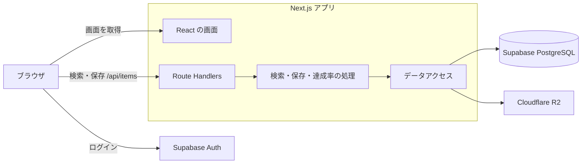

# アーキテクチャ

採用理由と比較した構成は [技術選定・ADR 一覧](02_tech-stack.md) を参照。

## 初期版の構成

本人用の非公開コレクション帳を、一つの Next.js アプリとして開発・配信する。下図はこれから実装する構成を示す。

画面は検索条件の入力と表示を担当する。Route Handler は認証、入力検証、HTTP 応答を担当し、検証済みの所有者 ID と検索条件を検索処理に渡す。検索条件の解釈、達成率の計算、保存時のルールには React、Cookie、Next.js の Request 型を持ち込まない。SQL と R2 の操作はサーバー側のデータアクセス層にまとめる。

## 検索・保存の境界

- 検索例は `GET /api/items?series=夏祭り&owned=false`。所有者・シリーズ・所持数ゼロで絞り込み、ページ単位で結果を返す。検索条件、並び順、ページング、応答の形式は画面と API の間で共有する。
- 登録は `POST /api/items`、編集・削除は `PATCH`・`DELETE /api/items/{id}` を想定する。所有者は認証情報から決め、取得・変更・画像操作のたびに対象の所有者を確認する。
- 画像は所有権を確認してから扱い、アップロード成功後にキーを DB に記録する。転送方式は API 経由または短命の署名付き URL を候補とする。DB と R2 の資格情報はサーバーで管理する。

## 将来、検索・保存を独立配信する場合

画面と別に API を更新・増強したい場合や、モバイルアプリと処理を共有したい場合に検討する。検索が重くなったときは、先に SQL の実行時間、接続待ち、インデックスを確認する。

1. まず読み取り専用の検索を対象に、検索条件・成功応答・エラー・所有者の扱いを HTTP 契約として固定する。新 API が同じ入力で同じ結果とアクセス制限を返すことを確認する。
2. 画面の検索先だけを新 API に切り替える。同一オリジンの `/api/items` を維持する場合はプロキシで振り分ける。新 API でも Supabase Auth の認証情報を検証する。
3. 保存も切り出す場合は、登録・編集・削除の書き込み先を操作ごとに一つに定めて切り替える。PostgreSQL、R2、既存の所有者 ID は両構成で利用できる。

切り出し後の構成例は「ブラウザ → Next.js で配信する画面 → 独立した API（Go など） → PostgreSQL / R2」。移行は機能単位で行える。
